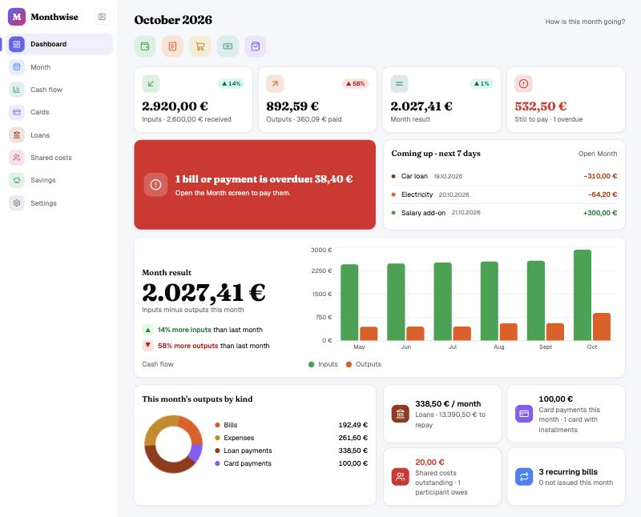
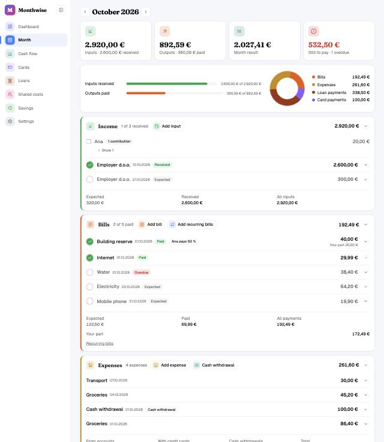

# Monthwise

Personal home finance app for tracking monthly income and expenses, credit card and loan installments, card statement reconciliation and savings.

Starting document with the domain, data model and architecture: [docs/INIT.md](docs/INIT.md).
Architecture decisions: [docs/decisions](docs/decisions/README.md). Working practices: [CONTRIBUTING.md](CONTRIBUTING.md).

## Screenshots

Shown with made-up data.

**Dashboard**: how the current month is going.



**Month**: inputs, bills, expenses, loan and card payments of a month.



## Development process

Every feature goes through the same steps on its own branch (details and rules in
[CONTRIBUTING.md](CONTRIBUTING.md#feature-workflow)). Nothing is committed or pushed before its
step is approved, and every commit message is approved first.

1. **Branch:** created from the latest `main` before the requirements are written.
2. **Requirements:** describe what the feature must do, without implementation details, in
   `docs/feature-requirements/`. Open questions are answered and written into the document. Once
   approved, it is committed as the first commit on the branch and pushed.
3. **Plan:** describe how it is built in `docs/plans/<branch-name>.md`, linking the requirements.
   Once approved, it is committed and pushed, before any code.
4. **Implementation:** built with tests, following the plan. The changes are left staged, not
   committed, for review; after the review they are committed (Conventional Commits) and pushed.
   If the approach changes, the plan is updated in the same branch.
5. **Pull request:** the final step, opened after the implementation is committed and pushed.
   Rebased on `main`, build and tests green, linking the plan and the requirements. It is merged
   with *Squash and merge*, so the branch's commits become one commit on `main`. The plan's status
   is set to `Done`.

When requirements that are already on `main` change later, the original text stays as approved
and the change is added as a numbered **appendix** at the end of the requirements document. The
plan of the branch making the change links and repeats that appendix.

### Documents in `docs/`

| Document | Purpose | When it is written |
|---|---|---|
| [INIT.md](docs/INIT.md) | Goal, domain, first data model and architecture of the whole app | Once at the start; updated when the data model or architecture changes |
| [feature-requirements/](docs/feature-requirements) | What a feature must do: attributes, functional and non-functional requirements, acceptance criteria; later changes as appendices | Before the plan, one per feature |
| [plans/](docs/plans) | How a feature is built: scope, design, steps, tests; links its requirements ([template](docs/plans/_TEMPLATE.md)) | After the requirements, one per branch |
| [decisions/](docs/decisions/README.md) | Architecture decision records (ADRs): one decision with its context and consequences | When a choice shapes the code base beyond one feature |

## Initial development setup

Do this once on a new machine. Never commit secrets: see [Secrets and sensitive data](CONTRIBUTING.md#secrets-and-sensitive-data).

### Prerequisites

- [.NET SDK 10](https://dotnet.microsoft.com/download) (see `backend/global.json`); check with `dotnet --list-sdks`
- [Node.js](https://nodejs.org/) 22.12 or newer (CI uses the version in `.nvmrc`)
- [Docker Desktop](https://www.docker.com/products/docker-desktop/) (or OrbStack) for the local PostgreSQL database
- [Visual Studio Code](https://code.visualstudio.com/) (optional, recommended)

### 1. Start Docker

Start Docker Desktop and finish its first-run setup. When it is running, a new terminal should answer:

```bash
docker --version
```

### 2. Create `.env` and choose a database password

```bash
cp .env.example .env
```

Edit `.env` and replace `POSTGRES_PASSWORD=change-me` with your own password. `.env` is git-ignored; never commit it.

### 3. Start PostgreSQL

```bash
docker compose up -d
docker compose ps        # monthwise-db should be "healthy"
```

PostgreSQL keeps running in the background. Stop it with `docker compose stop`; data stays in the
`monthwise-db-data` Docker volume.

### 4. Give the API the database password

`appsettings.Development.json` contains the connection string without a password. Store the full
connection string once in .NET user secrets (kept outside the repository, in your user profile), using
the password from `.env`:

```bash
cd backend
dotnet user-secrets set "ConnectionStrings:Monthwise" \
  "Host=localhost;Port=5432;Database=monthwise;Username=monthwise;Password=<POSTGRES_PASSWORD>" \
  --project src/Monthwise.Api
```

### 5. Create the encryption keys for card numbers

Card numbers and IBANs are stored encrypted ([ADR 0005](docs/decisions/0005-encrypted-sensitive-data.md)).
You create two random keys once: one encrypts the numbers, the other makes the fingerprints used to
detect duplicate cards. The API does not start without them.

**1. Generate the keys and show them.** Run this in one terminal (the values are kept in variables
until you close it):

```bash
ENCRYPTION_KEY=$(openssl rand -base64 32)
HASH_KEY=$(openssl rand -base64 32)
echo "Encryption key (k1): $ENCRYPTION_KEY"
echo "Hash key:            $HASH_KEY"
```

**2. Store them safely, now.** Copy both values into your password manager (or another safe place
outside this repository) before you continue, for example as two entries named
"Monthwise encryption key k1" and "Monthwise hash key". They are shown only here: without them,
stored card numbers and IBANs can never be read again, for example after a new computer or a
database restore. Never commit them or put them in `appsettings*.json`.

**3. Give them to the API** (same terminal):

```bash
cd backend
dotnet user-secrets set "SensitiveData:ActiveKeyId" "k1" --project src/Monthwise.Api
dotnet user-secrets set "SensitiveData:EncryptionKeys:k1" "$ENCRYPTION_KEY" --project src/Monthwise.Api
dotnet user-secrets set "SensitiveData:HashKey" "$HASH_KEY" --project src/Monthwise.Api
cd ..
unset ENCRYPTION_KEY HASH_KEY
```

On another computer, or after a reset, run only step 3 with the values from your password manager
(replace the variables with the saved values). Do not generate new keys for an existing database.

### 6. Install front-end packages

```bash
cd frontend
npm install
```

### 7. Run the app

**In VS Code:** open the `monthwise` folder (`code .`), install the recommended extensions when asked
(most importantly C# Dev Kit), open Run and Debug (Cmd+Shift+D / Ctrl+Shift+D), select
**Monthwise (API + front-end)** and press F5. This starts the API on http://localhost:5080, the Vite dev
server on http://localhost:5173 and opens Chrome, with breakpoints working in C# and React. The
configurations **API** and **Front-end (Chrome)** start each part on its own.

**From the terminal:** in two terminals run

```bash
cd backend && dotnet run --project src/Monthwise.Api
```

```bash
cd frontend && npm run dev
```

and open http://localhost:5173.

In Development the API applies database migrations on startup, and Vite forwards `/api` to the API.
The dashboard should show **API: Reachable** and **Database: Healthy**. Interactive API docs:
http://localhost:5080/scalar.

### 8. Run the tests (optional)

```bash
cd backend
MONTHWISE_TEST_DB="Host=localhost;Port=5432;Database=monthwise;Username=monthwise;Password=<POSTGRES_PASSWORD>" dotnet test
```

```bash
cd frontend && npm test
```

Without `MONTHWISE_TEST_DB` the back-end tests that need a real database are skipped. The tests use
their own made-up encryption keys.

### Troubleshooting

- **`dotnet --list-sdks` is empty or `dotnet build` says .NET 10 is missing:** another `dotnet` comes
  first in your `PATH` (for example `~/.dotnet` added by an editor extension in `~/.zshrc`). Check
  `which dotnet`, remove the extra entry from your shell profile, then quit and reopen the terminal app.
- **Database: Unhealthy on the dashboard:** check `docker compose ps` and that the password in user
  secrets matches `.env`.
- **API stops on startup with "SensitiveData:… is missing":** create the encryption keys (step 5).

## Everyday commands

| Where | Command | What it does |
|---|---|---|
| `backend` | `dotnet test` | domain and API tests (set `MONTHWISE_TEST_DB` to a connection string to include tests against a real database) |
| `backend` | `dotnet format` | apply code style |
| `backend` | `dotnet tool restore && dotnet ef migrations add <Name> --project src/Monthwise.Infrastructure --output-dir Persistence/Migrations` | add a migration |
| `frontend` | `npm test` / `npm run lint` / `npm run typecheck` / `npm run format` | tests, lint, types, formatting |
| `frontend` | `npm run api:generate` | regenerate the TypeScript API types after building the API (`backend/openapi/monthwise.json`) |

## Repository layout

```
backend/    .NET 10 solution: Domain, Application, Infrastructure, Api (+ tests)
frontend/   React + TypeScript app (Vite)
docs/       INIT.md, feature requirements, feature plans, architecture decisions
```
